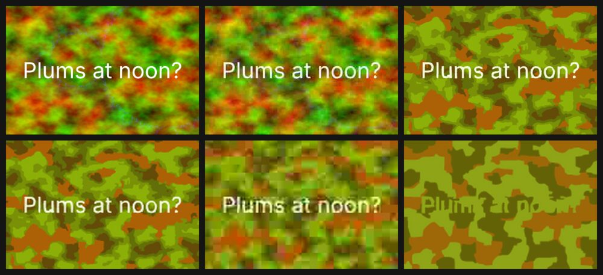

# PlumCraft graphs

Ready-to-run [PlumCraft](https://github.com/seantrue/plumcraft) graphs for the artcraft apps. Some are useful, some are silly, and every one runs. There is one graph for each of the 13 crafts, and nine more that cross engine borders, passing pictures, sound, SVG and spreadsheet rows from app to app.



*Broken telephone: the array engine draws a message, and PhotoCraft, VectorCraft, FigCraft, PhotoCraft and VectorCraft each pass on their own copy of it.*

## The graphs

**One craft each** (`graphs/crafts/<craft>/`):

| Craft | Graph | What it makes |
|---|---|---|
| CadCraft | Shelf-pin drilling template | A dimensioned bookcase side with 44 holes on the 32 mm system: PDF, SVG, DWG |
| DeckCraft | A pitch deck in one outline | A Markdown outline becomes a themed deck for a cat café in a data centre: PDF, PPTX, GIF |
| DesignCraft | Lost: one sock | A lost-property poster with tear-off tabs and an equation for the inevitable: PDF/X-4 |
| EffectCraft | A lower third for the evening news | An animated name strap, checked as three still frames |
| FigCraft | A design you can paste into code | An app card exported as PNG, SVG, CSS, SwiftUI and React |
| FilmCraft | A studio ident in ten seconds | Sunset footage, a grade and a title: MP4, GIF, poster frame |
| GridCraft | Is the espresso machine worth it? | A break-even workbook with a chart: PDF, CSV, the answer in months |
| PdfCraft | Read the fine print | Counts every "indemnify" in the terms for borrowing a lawnmower, stamps it and numbers the pages |
| PhotoCraft | Plums, five ways | Oil paint, noir, 1970s cross-process, pop art and moonlight from one photo |
| SolidCraft | A die you can 3D print | A 16 mm six-sided die: STL, 3MF, STEP, renders, mass |
| SoundCraft, Audio | A ringtone that isn't annoying | Synth hook, bass and drums: WAV, MIDI, MusicXML, and its loudness as Audio |
| VectorCraft | One badge, five stickers | Halftone, hand-drawn, bulge, 3D coin and risograph versions of an SVG |
| WordCraft | A firm but polite letter | A complaint to a smart-toaster company, from the letter template: PDF, Markdown |

**Across engines** (`graphs/crossings/`):

| Graph | Engines | What it does |
|---|---|---|
| Garden planner | GridCraft → CadCraft → VectorCraft | Beds in a spreadsheet become a dimensioned plan and a compost order |
| Laser-cut coasters | CadCraft → VectorCraft → array | A cut file with kerf allowance, and a preview colouring every part that falls out |
| Is the drummer rushing? | SoundCraft → audio → GridCraft | Finds every hit in a take, measures it against the click and gives a verdict |
| Is my photo clipping? | PhotoCraft → array → GridCraft | Histograms of before and after an edit, and the share of blown and crushed pixels |
| An album cover painted by its own music | SoundCraft → audio → array → PhotoCraft → FigCraft | Song → spectrogram → oil painting → cover |
| Broken telephone | array → PhotoCraft → VectorCraft → FigCraft → … → array | The parlour game, with pictures, plus a heat map of what was lost |
| Four sunsets, Warhol-style | FilmCraft → VectorCraft → array → PhotoCraft | A video frame screen-printed four ways |
| Launch day for a die | SolidCraft → PhotoCraft → FigCraft | One model makes the ad, the STL and the numbers |
| Bouncing-ball storyboard | EffectCraft → array | Twelve frames of a squash-and-stretch bounce on one sheet |

[`docs/catalogue.md`](docs/catalogue.md) has a picture of each one's real output, the files it writes, and something to try.

## Running them

You need PlumCraft and the craft apps each graph uses: `gridcraft-cli`, `vectorcraft-cli` and the rest on `PATH`. The text, array and audio engines come with PlumCraft.

**In the editor:** open a graph and press Run. The graph names its engines, so for example:

```sh
plumcraft-editor graphs/crossings/garden-planner.json --engine gridcraft,cadcraft,vectorcraft
```

Its Write Files nodes write into `out/` beside the graph.

**Without a window:**

```sh
scripts/graphs list                 # every graph, with its engines
scripts/graphs check                # check every graph against the live catalogues
scripts/graphs run                  # run every graph; files in out/<graph>/, a summary in out/REPORT.md
scripts/graphs run graphs/crossings/broken-telephone.json
```

`scripts/graphs` wraps `plumcraft-editor check`, `run` and `tidy`. It uses `$PLUMCRAFT_EDITOR`, then `plumcraft-editor` on `PATH`, then the installed app.

> **Needs a PlumCraft newer than 0.1.0.** Headless runs of graphs that end in Write Files, and `check` and `tidy`, are on PlumCraft's `headless-write-files` branch and not released yet. Until they are, build that branch and point the script at it:
> `PLUMCRAFT_EDITOR=../plumcraft/target/debug/plumcraft-editor scripts/graphs run`.
> The editor in the 0.1.0 installers opens and runs every graph with a window.

All 22 graphs ran on 2026-11-02, and all 23 on 2026-11-03, with PlumCraft's `headless-write-files` branch and the craft apps then on the maintainer's machine.

## How the project is laid out

```text
graphs/crafts/<craft>/   one graph per craft app
graphs/crossings/        graphs that cross engines
assets/                  the inputs some graphs open (a photo, a contract, an SVG badge), with CREDITS.md
docs/catalogue.md        every graph: picture, files written, what to try
docs/writing-graphs.md   conventions, and the tricks the crafts need
docs/findings.md         gaps in PlumCraft and the crafts that these graphs found
docs/images/             the pictures, from real runs
scripts/graphs           list, check, run and tidy
```

## Writing your own

Copy the nearest graph, open it in the editor, and change it there. [`docs/writing-graphs.md`](docs/writing-graphs.md) covers the file format, the conventions used here, and what each craft needs: which crafts open pictures, how selection works, and the type gaps to route around. Run `scripts/graphs check` before you commit.

## Licence

MIT or Apache-2.0, at your choice (`LICENSE-MIT`, `LICENSE-APACHE`). The plum photograph is CC BY 2.0 and is credited in [`assets/CREDITS.md`](assets/CREDITS.md).
