# The graphs

Generated from each graph's `meta` and the files a run made. Pictures are real outputs. Regenerate with `claude-debug/make_catalogue.py` (scratch, untracked) after a run.

## One craft each

Each graph uses one craft app (plus PlumCraft's building blocks, such as Write Files).

### Shelf-pin drilling template

`graphs/crafts/cadcraft/shelf-pin-template.json` · engines: cadcraft · 26 nodes, 25 wires

CadCraft only. A 280 × 900 mm bookcase side with two columns of 5 mm shelf-pin holes on the 32 mm system, 37 mm in from each edge, dimensioned and labelled on separate layers. The DWG is true scale, for a CNC or for tiling a 1:1 print from a CAD program; the PDF and PNG are fitted to the page as a shop drawing (the 100 mm bar shows the scale of any printout). Change the panel size or pitch in the nodes to fit your cabinet; the hole count comes out as JSON as a check.

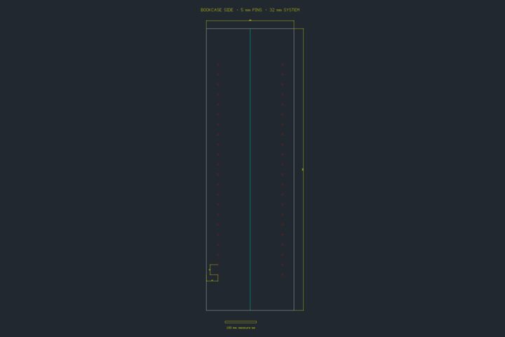

**Writes:** `hole-count.json`, `shelf-pins.dwg`, `shelf-pins.pdf`, `shelf-pins.png`, `shelf-pins.svg`

**Try:** Change the circle radius to 3.5 mm for 7 mm pins, or the array rows for a taller panel.

### A pitch deck in one outline

`graphs/crafts/deckcraft/cat-cafe-pitch.json` · engines: deckcraft · 17 nodes, 16 wires

DeckCraft only. A Markdown outline becomes a themed, numbered deck with transitions and speaker notes, then a PDF, a PowerPoint file and an animated GIF to post. The startup is a cat café inside a data centre. Edit the outline and every export follows.

**Writes:** `purrfect-uptime.gif`, `purrfect-uptime.pdf`, `purrfect-uptime.png`, `purrfect-uptime.pptx`

**Try:** Rewrite the outline; theme Nocturne can become Harbor, Ember, Meadow, Paper, Coral Reef or Slate.

### Lost: one sock

`graphs/crafts/designcraft/lost-sock-poster.json` · engines: designcraft · 33 nodes, 32 wires

DesignCraft only. A Letter-size lost-property poster with a plum swatch, a big headline, a description, an equation for the statistically inevitable, and eight tear-off phone tabs along the bottom, each rotated a quarter turn. Preflight reports any problems before it goes to the printer, then a PDF/X-4 and a PNG proof come out.

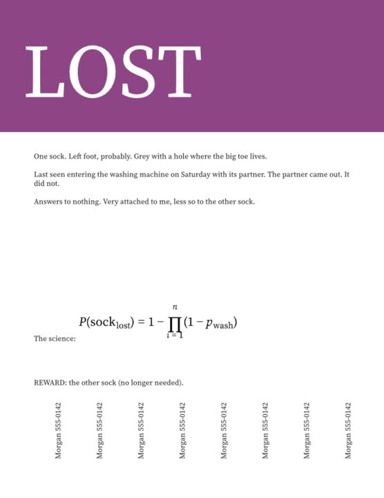

**Writes:** `lost-sock.pdf`, `lost-sock.png`, `preflight.json`

**Try:** Replace the text frames; the tear-off tabs are rotated by id, so add frames after them, not before.

### A lower third for the evening news

`graphs/crafts/effectcraft/lower-third.json` · engines: effectcraft · 19 nodes, 18 wires

EffectCraft only. A broadcast lower third: a plum bar wipes in from the left, the name fades up over it, and a thin accent line breathes with an expression. Three frames come out (as it starts, mid-move and settled) so you can check the animation without rendering video. Rename the expert in the Text layer nodes.

**Writes:** `layers.json`, `lower-third-0.15s.png`, `lower-third-0.60s.png`, `lower-third-2.50s.png`

**Try:** Change the name and role in the two Text layer nodes.

### A design you can paste into code

`graphs/crafts/figcraft/design-to-code.json` · engines: figcraft · 19 nodes, 18 wires

FigCraft only. An onboarding card for a plant-watering app ('Your fern misses you'), built from frames, shapes and text with auto layout and a soft shadow, exported as PNG and SVG, and as CSS, SwiftUI and React from Inspect code. The JSON files are the code.

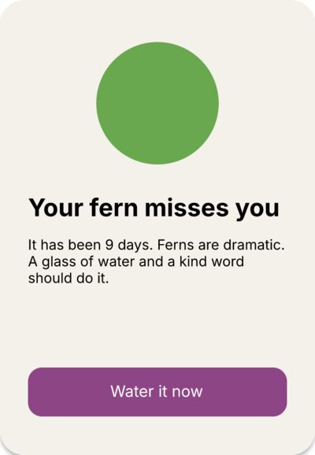

**Writes:** `card-css.json`, `card-react.json`, `card-swiftui.json`, `onboarding-card.png`, `onboarding-card.svg`

**Try:** Add languages: html, tailwind, vue, compose, leptos, arkui.

### A studio ident in ten seconds

`graphs/crafts/filmcraft/studio-ident.json` · engines: filmcraft · 16 nodes, 16 wires

FilmCraft only. Plum Pictures' opening ident: demo sunset footage on a sequence, a Golden Dusk look, a title over it, then an MP4, a GIF for the group chat and a poster frame. Swap the scene (Aurora, CityNight, Dunes, Plasma, Forest) or the words.

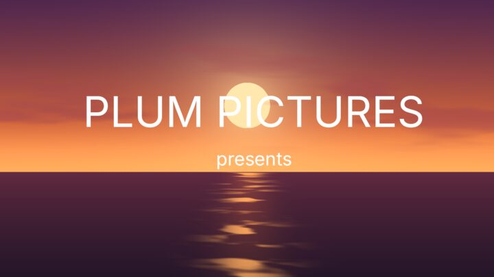

**Writes:** `plum-pictures-frame.png`, `plum-pictures.gif`, `plum-pictures.mp4`, `sequence.json`

**Try:** Scenes: OceanSunset, Aurora, CityNight, Dunes, Plasma, Forest. Looks: Night Exterior, Steel Blue, Faded Print…

### Is the espresso machine worth it?

`graphs/crafts/gridcraft/espresso-break-even.json` · engines: gridcraft · 21 nodes, 20 wires

GridCraft only. Change the inputs in Write inputs (machine price, cups a week, what the café charges) and the workbook works out how many months until a home espresso machine pays for itself, charts café against home spending over two years, and writes a PDF, a CSV and the break-even month as JSON.

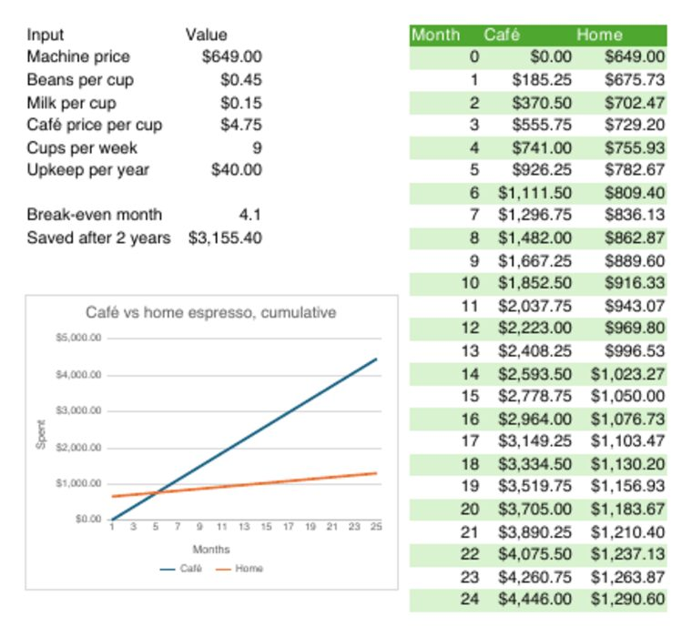

**Writes:** `break-even-months.json`, `espresso.csv`, `espresso.pdf`

**Try:** Set cups per week to 2 and watch the break-even month run past the end of the chart.

### Read the fine print

`graphs/crafts/pdfcraft/fine-print.json` · engines: pdfcraft · 17 nodes, 16 wires

PdfCraft only. Opens a contract nobody reads (the terms for borrowing a neighbour's lawnmower), counts the words and every 'indemnify', stamps it READ ME, numbers the pages, makes its URLs clickable and checks its accessibility. The JSON answers the question you should ask of any contract: how many times does it make you pay for things?

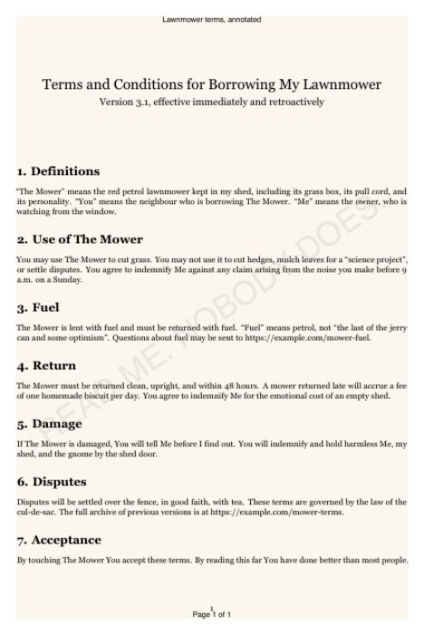

**Writes:** `accessibility.json`, `document-info.json`, `indemnify.json`, `terms-annotated.pdf`, `terms.txt`, `word-count.json`

**Try:** Point Open at any PDF you are about to sign and change Find text to 'liable', 'perpetual' or 'arbitration'.

### Plums, five ways

`graphs/crafts/photocraft/plums-five-ways.json` · engines: photocraft · 27 nodes, 26 wires

PhotoCraft only. One photograph of Santa Rosa plums, five looks: an oil painting, gritty black and white, a 1970s cross-processed print, a four-colour pop-art poster, and a moonlit night. Also asks the face detector whether it sees faces in the fruit (pareidolia check). Photo: 'Santa Rosa Plums' by SummerTomato, CC BY 2.0, cropped (assets/CREDITS.md).

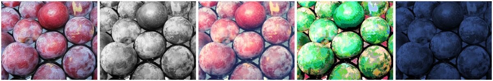

**Writes:** `faces-in-the-fruit.json`, `plums-night.jpg`, `plums-noir.jpg`, `plums-oil.jpg`, `plums-pop.jpg`, `plums-seventies.jpg`

**Try:** Open your own photo; each look is a short chain you can reorder.

### A die you can 3D print

`graphs/crafts/solidcraft/six-sided-die.json` · engines: solidcraft · 37 nodes, 36 wires

SolidCraft only. A 16 mm six-sided die: a cube intersected with a sphere for the classic rounded corners, then 21 pips cut as spheres with opposite faces adding to seven. Exports STL and 3MF for the slicer, STEP for CAD, two renders, and the measured volume so you know how much filament it takes. Change the size or pip radius in the nodes.

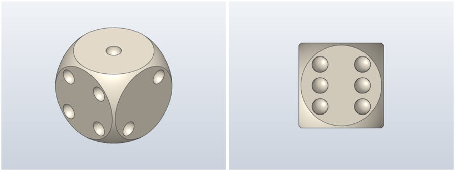

**Writes:** `die-16mm.3mf`, `die-16mm.step`, `die-16mm.stl`, `die-bottom.png`, `die-iso.png`, `die-measure.json`

**Try:** Pip radius 1.5 → 1.8 for bolder pips; the measure JSON tells you what it does to the mass.

### A ringtone that isn't annoying

`graphs/crafts/soundcraft/ringtone.json` · engines: soundcraft, audio · 24 nodes, 23 wires

SoundCraft, with the audio engine for the bounce as Audio. Four bars at 104 BPM: a bright synth hook, a bass line, and a drum-synth groove, with a little delay and plate reverb on the hook so it sounds expensive. Bounces a normalized WAV for your phone, and exports MIDI and MusicXML so you can take it into a notation app. Change the notes in the MIDI notes nodes and everything follows. WAV to Audio turns the bounce into Audio, ready for any Audio input; here it's measured with Loudness, and the reading saved.

**Writes:** `ringtone-loudness.json`, `ringtone.mid`, `ringtone.musicxml`, `ringtone.wav`, `session.json`

**Try:** The notes are plain JSON (pitch, start_ticks, length_ticks, velocity) at 960 ticks a beat.

### One badge, five stickers

`graphs/crafts/vectorcraft/sticker-sheet.json` · engines: vectorcraft · 30 nodes, 29 wires

VectorCraft only. A hand-written SVG plum badge becomes a sheet of sticker variants: a print-shop halftone, a wobbly hand-drawn version, a bulging 'warp' version, a 3D extruded coin, and a two-colour risograph recolour. Each is exported as SVG and PNG; the palette of the original comes out as JSON.

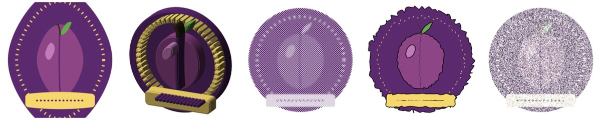

**Writes:** `palette.json`, `sticker-bulge.png`, `sticker-bulge.svg`, `sticker-coin.png`, `sticker-coin.svg`, `sticker-halftone.png`, `sticker-halftone.svg`, `sticker-handdrawn.png`, `sticker-handdrawn.svg`, `sticker-riso.png`, `sticker-riso.svg`

**Try:** Open your own SVG logo.

### A firm but polite letter

`graphs/crafts/wordcraft/toaster-complaint.json` · engines: wordcraft · 20 nodes, 19 wires

WordCraft only. The letter template, filled in by Replace all: a complaint to a smart-toaster company whose firmware update made every slice of toast say 'HELLO'. Change the replacements and you have your own letter, as PDF, Markdown and a page-one PNG.

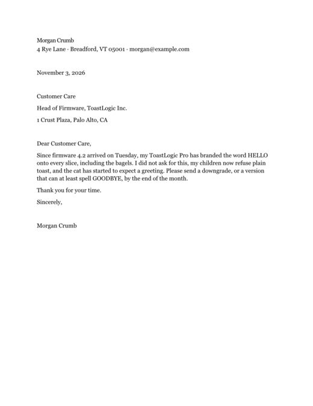

**Writes:** `letter.md`, `letter.pdf`, `letter.png`, `word-count.json`

**Try:** Point the replacements at your own grievance; the template's other text stays put.

## Across engines

Each graph crosses two to five engines; values move between them unchanged, by content handle.

### An album cover painted by its own music

`graphs/crossings/album-cover.json` · engines: soundcraft, audio, array, photocraft, figcraft · 33 nodes, 34 wires

SoundCraft → audio engine → array engine → PhotoCraft → FigCraft. SoundCraft plays the title track of 'Pits & Pieces' by The Stone Fruits; the audio engine turns the bounce into a spectrogram; the array engine colours it from plum (quiet) to apricot (loud); PhotoCraft paints it in oils; FigCraft sets the band name and title. Change the notes and the cover changes with them.

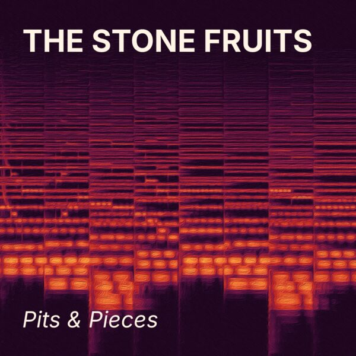

**Writes:** `pits-and-pieces-cover.png`, `pits-and-pieces.wav`, `spectrogram-coloured.png`

**Try:** Change a chord, or the hue span (90° plum→apricot; try 180° for plum→green).

### Bouncing-ball storyboard

`graphs/crossings/bounce-storyboard.json` · engines: effectcraft, array · 46 nodes, 56 wires

EffectCraft → array engine. The first exercise of every animation course: a ball that bounces, squashing as it lands and stretching as it leaves, driven entirely by expressions. EffectCraft renders twelve frames across one second; the array engine lays them out as a storyboard sheet with a frame line, which is how you check timing and spacing without playing anything.

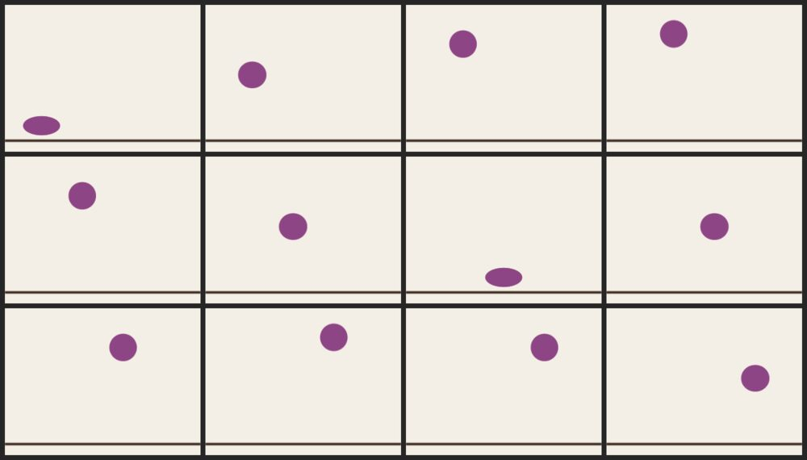

**Writes:** `bounce-storyboard.png`

**Try:** Edit the expressions: the 6 in pow(v, 6) sets how sharp the squash is.

### Broken telephone

`graphs/crossings/broken-telephone.json` · engines: array, photocraft, vectorcraft, figcraft · 46 nodes, 52 wires

array → PhotoCraft → VectorCraft → FigCraft → PhotoCraft → VectorCraft → array. The parlour game with pictures: the array engine draws a message, and each craft in turn opens what the last one handed over and passes on its own export: a cheap JPEG, an Image Trace, a half-size PNG, another cheap JPEG, a three-colour trace. The array engine lays every hop side by side and maps what was lost on the way as a heat map. Values cross six engine borders unchanged; the damage is all the crafts' own.

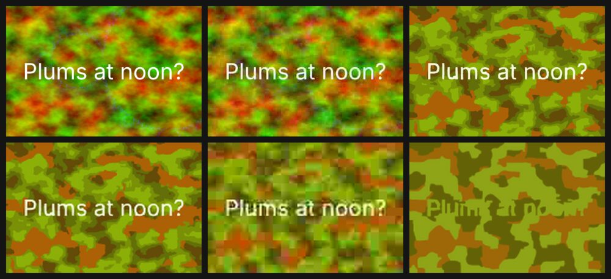

**Writes:** `every-hop.png`, `what-was-lost.png`

**Try:** Change the message, or the JPEG qualities; add a hop by copying an Open/Export pair.

### Launch day for a die

`graphs/crossings/die-launch.json` · engines: solidcraft, photocraft, figcraft · 42 nodes, 41 wires

SolidCraft → PhotoCraft → FigCraft. SolidCraft models the 16 mm die (cube ∩ sphere, 21 pips) in plum and renders it; PhotoCraft gives the render a studio touch-up; FigCraft lays it out as a crowdfunding ad (PNG and PDF). The STL and the measured volume and mass come from the same model, so the ad, the print file and the numbers can't disagree.

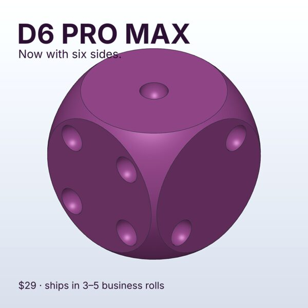

**Writes:** `d6-pro-max-ad.pdf`, `d6-pro-max-ad.png`, `d6-pro-max.stl`, `die-measure.json`

**Try:** Change the colour in Appearance; ad, STL and render all follow.

### Is the drummer rushing?

`graphs/crossings/drummer-rushing.json` · engines: soundcraft, audio, gridcraft · 23 nodes, 22 wires

SoundCraft → audio engine → GridCraft. SoundCraft plays sixteen beats at 100 BPM from a drummer who drifts ahead of the click; the audio engine finds every hit in the bounce, and GridCraft lines each one up against where it should have landed, charts the error in milliseconds and gives a verdict. Swap the notes for a real take (Load audio) to judge a real drummer.

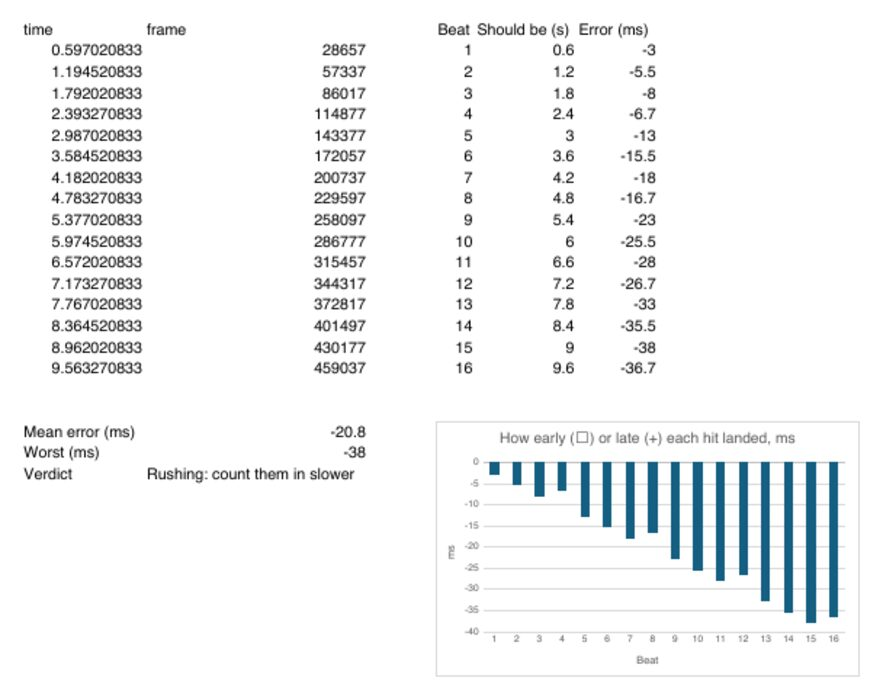

**Writes:** `loudness-lufs.json`, `the-take.wav`, `timing.pdf`, `verdict.txt`

**Try:** Replace the take: Load audio of a real recording into Transients instead of the SoundCraft bounce.

### Garden planner: from a spreadsheet to a plan

`graphs/crossings/garden-planner.json` · engines: gridcraft, cadcraft, vectorcraft · 37 nodes, 39 wires

GridCraft → CadCraft → VectorCraft. The beds live in a spreadsheet (position, size), which also works out the area, the soil each bed needs at 30 cm deep and how many 50-litre bags of compost to buy. GridCraft computes each bed's corners, CadCraft draws them inside the fence as a dimensioned plan, and VectorCraft turns the drawing into a friendly hand-drawn plan to stick on the shed door. Move a bed in the spreadsheet and the plan follows.

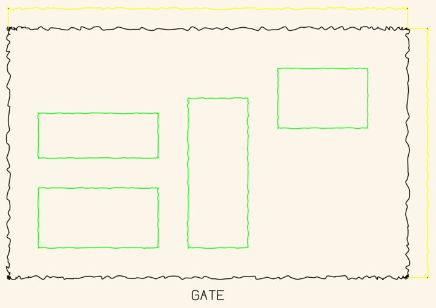

**Writes:** `beds.pdf`, `compost-bags.json`, `plan-dimensioned.pdf`, `plan-for-the-shed.png`, `plan-for-the-shed.svg`

**Try:** Move a bed in Bed table (x, y, width, depth): the drawing and the compost order follow.

### Laser-cut coasters

`graphs/crossings/laser-cut-coasters.json` · engines: cadcraft, vectorcraft, array · 35 nodes, 36 wires

CadCraft → VectorCraft → array engine. CadCraft draws a 95 mm coaster with a ring of twelve vent holes and a hexagon centre; VectorCraft makes it cutter-ready (hairline red cut strokes, outlines offset by half the 0.1 mm kerf); the array engine rasterizes the cut file and labels each separate piece, so you can see at a glance how many parts will fall out of the sheet before you burn any plywood. Outputs the cut SVG and PDF and the parts preview.

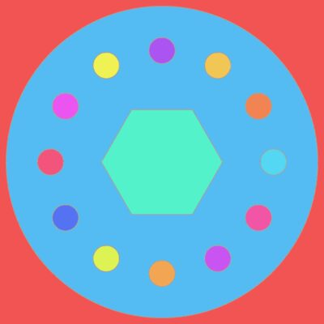

**Writes:** `coaster-cut.pdf`, `coaster-cut.svg`, `coaster-drawing.pdf`, `coaster-parts.png`

**Try:** Change the vent count in Polar array, then count the colours in the parts preview.

### Is my photo clipping?

`graphs/crossings/photo-clipping.json` · engines: photocraft, array, gridcraft · 45 nodes, 49 wires

PhotoCraft → array engine → GridCraft. PhotoCraft gives the plums an aggressive 'Instagram' edit (auto tone, +35 brightness, +90 contrast, a hot colour lookup); the array engine takes a 32-bin histogram of each channel of the before and the after; GridCraft charts them and counts how much of each channel is crushed to black or blown to white. The PDF answers 'did I overdo it?' with numbers.

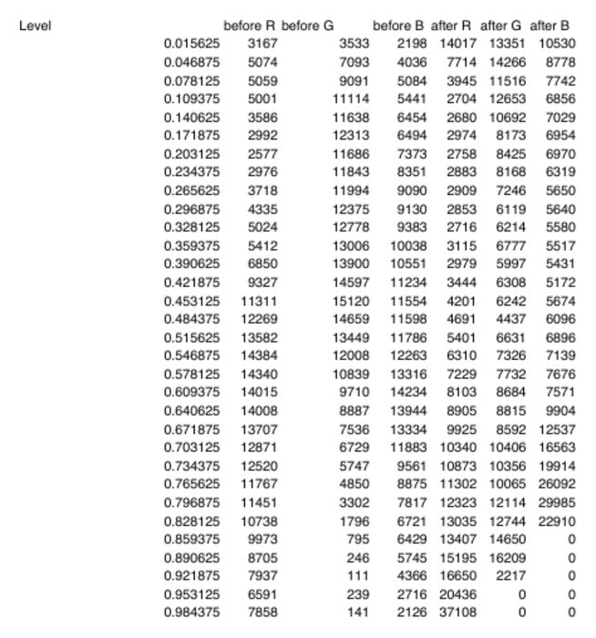

**Writes:** `histograms.pdf`, `plums-after.png`, `verdict.txt`

**Try:** Push contrast to 100, or try the noir chain from Plums, five ways, and see the verdict change.

### Four sunsets, Warhol-style

`graphs/crossings/warhol-sunsets.json` · engines: filmcraft, vectorcraft, array, photocraft · 35 nodes, 38 wires

FilmCraft → VectorCraft → array engine → PhotoCraft. FilmCraft renders a frame of its ocean-sunset footage; VectorCraft traces it into flat colour and makes four hue-shifted screen prints; the array engine tiles them two by two; PhotoCraft adds paper grain and a faded-film look so it reads as a print. Pick another scene in Demo footage for a different set.

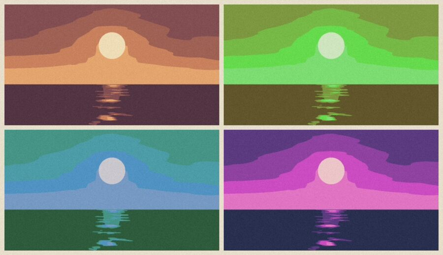

**Writes:** `four-sunsets.jpg`, `the-frame.png`

**Try:** Scene Plasma or Aurora; hue shifts in the four Hue/Saturation nodes.
